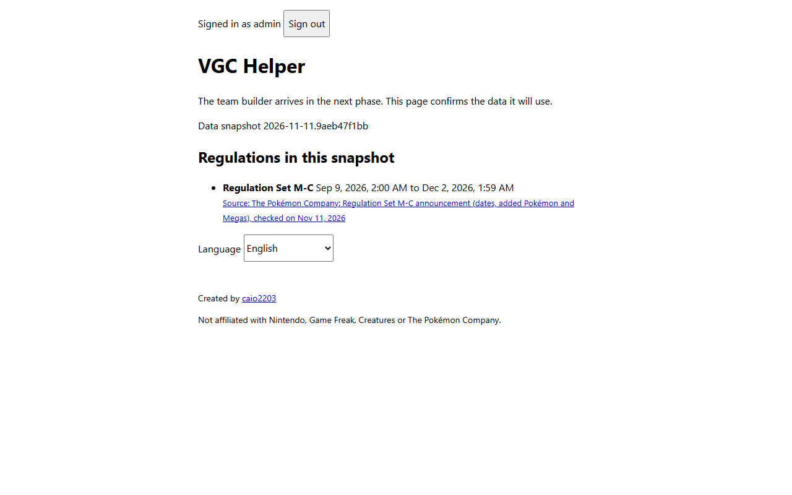
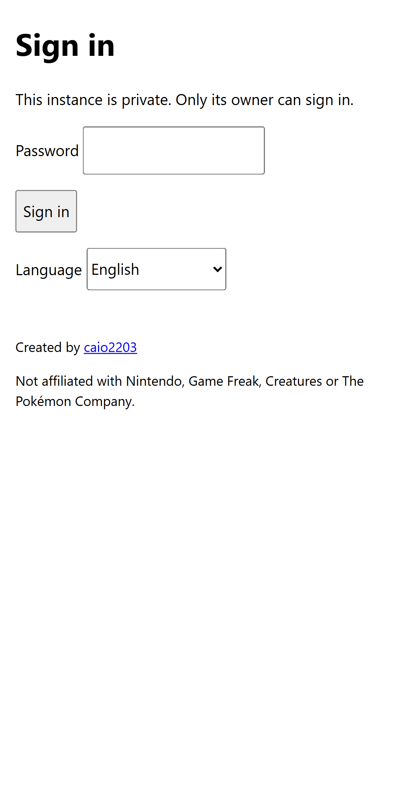
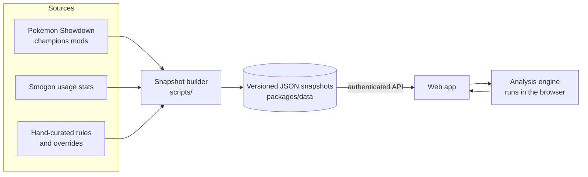
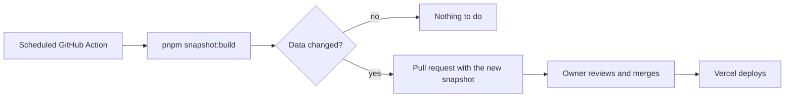

# VGC Helper

**English** · [Português (Brasil)](README.pt-BR.md)

Build competitive Pokémon teams and see, as you build, what the team is weak to, what it is
missing and what the current meta is running. VGC (Doubles) first, Singles next.

[](https://github.com/caio2203/vgc-helper/actions/workflows/ci.yml)
[](LICENSE)
[](https://github.com/caio2203/vgc-helper/releases)

> **Status: early development.** The foundation is in place (sign-in, data pipeline, Pokémon
> Champions Reg M-C data). The team builder and the analysis come next — see the
> [roadmap](#roadmap).

## Screenshots

What exists today: the sign-in screen and the signed-in page, which confirms the data snapshot
the builder will use. The visual design arrives in Phase 2; the team builder screenshots and a
short GIF (add a Pokémon → see the alert → accept a suggestion) arrive in Phase 3.

<p>
  <picture>
    <source media="(prefers-color-scheme: dark)" srcset="docs/images/home-desktop-dark.png">
    
  </picture>
  <picture>
    <source media="(prefers-color-scheme: dark)" srcset="docs/images/login-mobile-dark.png">
    
  </picture>
</p>

The images are generated from a throwaway local instance with
`pnpm --filter @vgc-helper/web screenshots`.

## Why I built this

Pokémon Champions made competitive Pokémon way easier to get into. The catch: the meta keeps shifting, and I (sadly) can't keep up with all of it. So I built the helper I wish I had.

The idea is to help everyone, from first-timers to veterans, build teams faster and with less headache. Instead of spending hours alone with pen and paper and then getting absolutely wrecked on Showdown (lol), you build your team and the app shows its weaknesses, what's missing and what the meta is running.

Hope you enjoy it! Feel free to suggest improvements, share tips, report bugs and spin up your own copy to use however you like.

## Features

Available now:

- Private by design: one owner per instance, GitHub sign-in limited to your numeric GitHub id
  (or a local password when running on your own PC).
- Pokémon Champions data for Regulation Set M-C: legal species, Megas, moves, items, abilities
  and learnsets, plus monthly usage stats for VGC and Singles. Every dataset carries its source
  and date.
- Interface in English and Brazilian Portuguese.

Planned (see the roadmap):

- Team builder with legality checks (Stat Points, Item and Species Clause, one Mega).
- Live analysis without AI: type matrix, stacked weaknesses, meta threats with damage calcs,
  speed tiers, VGC role checklist, archetype detection.
- Suggestions with an explained score and a common set, based on usage and tournament data.
- Showdown paste import and export.
- On-demand explanations and chat with Google Gemini (free tier), with a full fallback without it.

## How it works



The competitive data is not in a database. It lives as versioned, zod-validated JSON in the
repository, so every change can be reviewed in a pull request:



## Stack

| Part     | Choice                                                        |
| -------- | ------------------------------------------------------------- |
| Monorepo | pnpm workspaces, Turborepo, TypeScript (strict)               |
| API      | NestJS, Passport (GitHub OAuth), Drizzle ORM, libSQL / SQLite |
| Web      | React, Vite, TanStack Router and Query, react-i18next         |
| Engine   | Pure TypeScript package shared by the web app and the API     |
| Data     | zod schemas, `@pkmn/dex` + `@pkmn/mods`, Smogon stats         |
| Tests    | Vitest, Supertest, Playwright, axe                            |
| Hosting  | Vercel (Hobby) + Turso (Free)                                 |
| Quality  | Biome, commitlint, husky, CodeQL, Dependabot, release-please  |

## Quick start (on your PC)

Requirements: [Node.js 24](https://nodejs.org/) and pnpm 12 (`npm install -g pnpm@12`).

```bash
git clone https://github.com/caio2203/vgc-helper.git
cd vgc-helper
pnpm install
cp .env.example .env
```

In `.env`, set `SESSION_SECRET` (see the comment in the file for a command that generates one)
and keep `AUTH_MODE=local-password`. Then create your password hash and paste it into
`ADMIN_PASSWORD_HASH`:

```bash
pnpm hash-password
```

Start the app:

```bash
pnpm dev
```

Open http://localhost:5173 and sign in with your password. Data is stored in a local SQLite file
(`apps/api/local.db`).

To run it as a single process instead (the API also serves the built web app):

```bash
pnpm build
```

Then start it with `APP_ORIGIN=http://localhost:3000` and `SERVE_WEB_DIR=../web/dist` (relative to `apps/api`) set in
`.env`:

```bash
pnpm start
```

## Deploy your own copy (Vercel + Turso)

Both services have free plans that are enough for one person. The full step-by-step guide,
with every value to fill in, is in [docs/setup.md](docs/setup.md). In short:

1. Fork this repository.
2. Create a Turso database and a token for it.
3. Import the fork in Vercel. `vercel.json` already sets the build, the function and the routes.
4. Add the environment variables below for **Production** and **Preview**.
5. Turn on **Vercel Authentication** for **All Deployments** (Settings → Deployment Protection).
6. Create a GitHub OAuth app with the callback `https://<your-domain>/api/auth/github/callback`.

## Sign-in options

| Mode             | Use it for                      | Variables                                                             |
| ---------------- | ------------------------------- | --------------------------------------------------------------------- |
| `github`         | Your online instance            | `GITHUB_CLIENT_ID`, `GITHUB_CLIENT_SECRET`, `AUTH_ALLOWED_GITHUB_IDS` |
| `local-password` | Your PC, or preview deployments | `ADMIN_PASSWORD_HASH` (from `pnpm hash-password`)                     |

`AUTH_ALLOWED_GITHUB_IDS` takes numeric ids, not usernames, because a username can change. Find
yours at `https://api.github.com/users/<your-username>` (the `id` field). Any other account is
sent back to the login screen and nothing is stored for it. There is no sign-up and no setup
screen: if authentication is not configured, the API refuses to start.

## Environment variables

| Variable                  | Required            | Description                                                        |
| ------------------------- | ------------------- | ------------------------------------------------------------------ |
| `APP_ORIGIN`              | yes                 | Address you open in the browser, e.g. `https://helper.example.com` |
| `SESSION_SECRET`          | yes                 | At least 32 random characters                                      |
| `AUTH_MODE`               | yes                 | `github` or `local-password`                                       |
| `GITHUB_CLIENT_ID`        | github mode         | OAuth app client id                                                |
| `GITHUB_CLIENT_SECRET`    | github mode         | OAuth app client secret                                            |
| `AUTH_ALLOWED_GITHUB_IDS` | github mode         | Comma-separated numeric GitHub ids                                 |
| `ADMIN_PASSWORD_HASH`     | local-password mode | Output of `pnpm hash-password`                                     |
| `DATABASE_URL`            | no                  | Local SQLite file, default `file:local.db`                         |
| `TURSO_DATABASE_URL`      | on Vercel           | `libsql://…` URL of the Turso database                             |
| `TURSO_AUTH_TOKEN`        | on Vercel           | Turso database token                                               |
| `CRON_SECRET`             | on Vercel           | 16+ characters; lets the daily cron keep the free database active  |
| `SESSION_TTL_DAYS`        | no                  | Session length in days, default 30                                 |
| `SERVE_WEB_DIR`           | no                  | Serve the built web app from the API (single process)              |
| `PORT`                    | no                  | API port for local runs, default 3000                              |

## Data sources and credits

- [Pokémon Showdown](https://github.com/smogon/pokemon-showdown) (MIT) — game data for the
  Pokémon Champions mods, packaged by [pkmn](https://github.com/pkmn/ps) (MIT).
- [Smogon University usage statistics](https://www.smogon.com/stats/) — monthly usage, sets,
  spreads and teammates.
- Official announcements by The Pokémon Company — regulation dates and rules, credited next to
  the data in `packages/data/manual`.

The [NOTICE](NOTICE) file lists the credits that must travel with every copy.

## Roadmap

- [x] **Phase 0** — research: rules, data sources, hosting limits
- [ ] **Phase 1** — foundation: monorepo, CI, sign-in, database, i18n, first data snapshot, first deploy
- [ ] **Phase 2** — design system, team builder, legality, paste import/export, search, shortcuts
- [ ] **Phase 3** — analysis engine, suggestions, experience levels, feedback, damage calculator
- [ ] **Phase 4** — data pipeline with readable diffs, "What's new" page, team revalidation
- [ ] **Phase 5** — team preview: which 4 to bring against an open team list
- [ ] **Phase 6** — on-demand AI explanations and chat (Gemini)
- [ ] **Phase 7** — Singles analysis profile
- [ ] **Phase 8** — Scarlet/Violet and Smogon formats

## Contributing

Issues and pull requests are welcome. Read [CONTRIBUTING.md](CONTRIBUTING.md) first. For wrong
meta data or a new regulation, use the matching issue template. Report security problems
privately as described in [SECURITY.md](SECURITY.md).

## License

[Apache License 2.0](LICENSE). You can use, change and redistribute this project, including
commercially. Keep the [NOTICE](NOTICE) file in any copy you distribute, and please keep the
"Created by caio2203" credit in the app.

## Disclaimer

VGC Helper is a fan project. It is not affiliated with, endorsed by or sponsored by Nintendo,
Game Freak, Creatures or The Pokémon Company. Pokémon and all related names are trademarks of
their respective owners.
