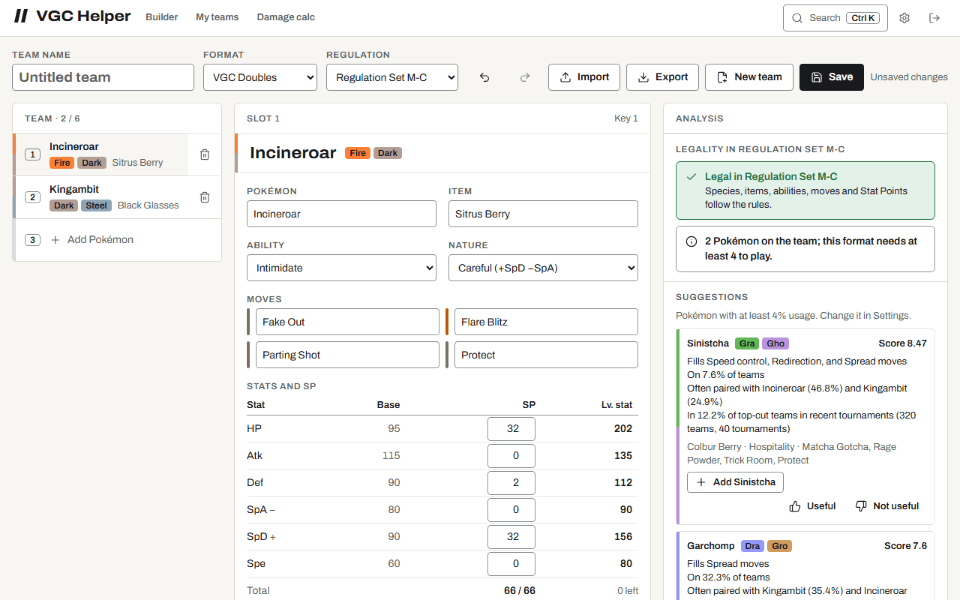
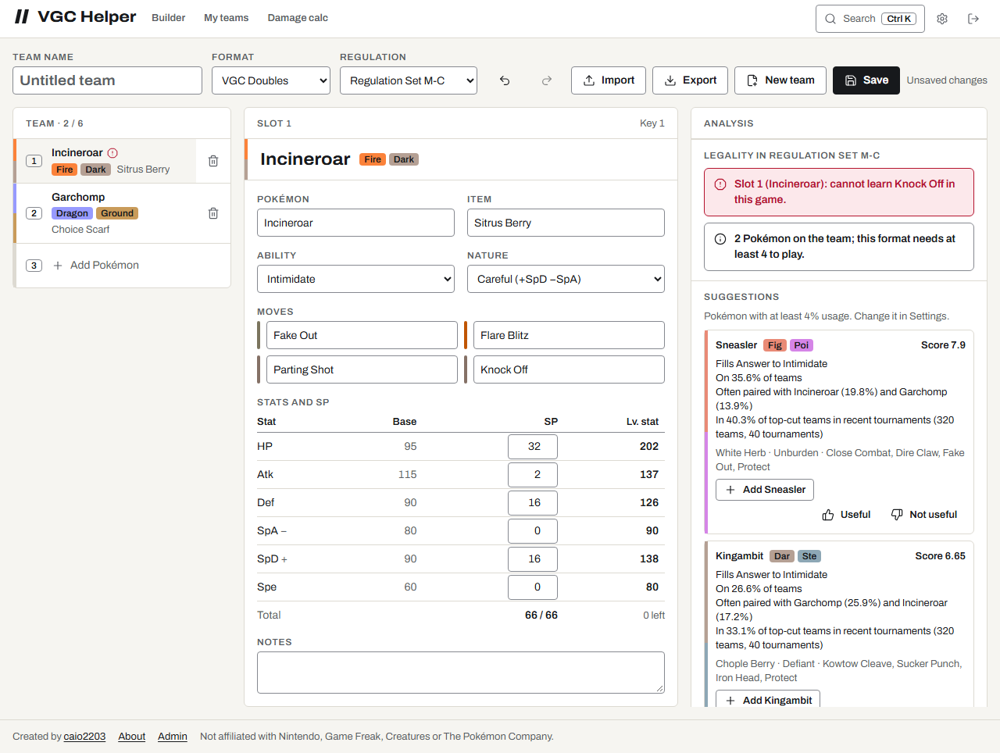
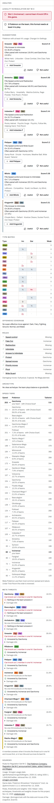
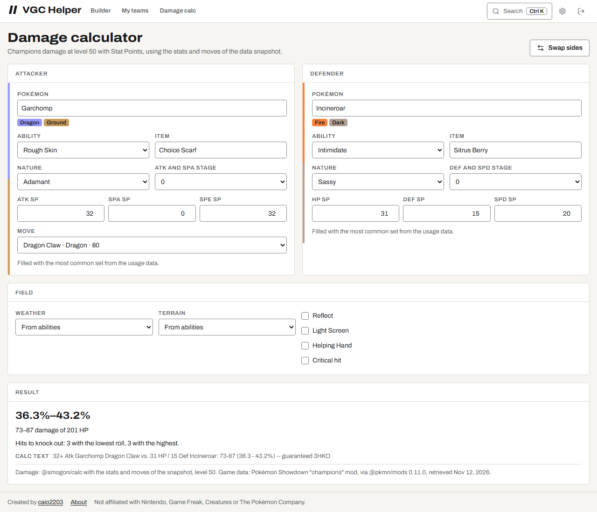
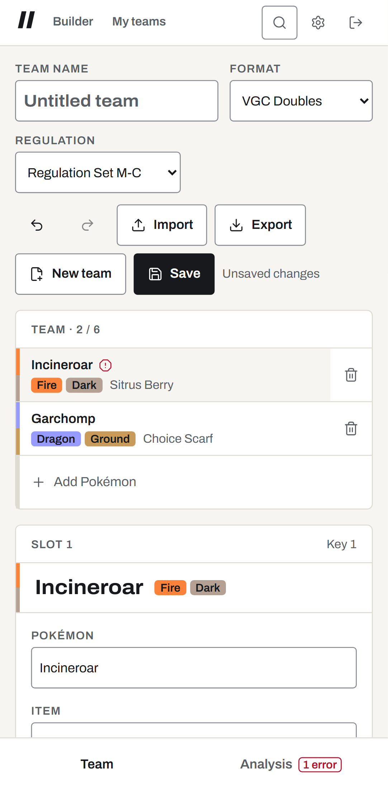
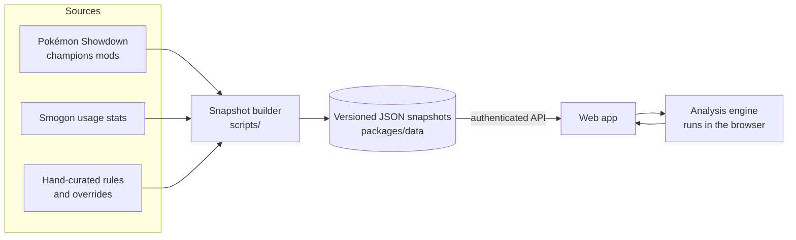
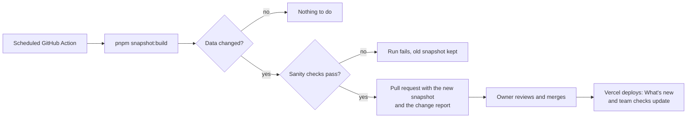

# VGC Helper

**English** · [Português (Brasil)](README.pt-BR.md)

Build competitive Pokémon teams and see, as you build, what the team is weak to, what it is
missing and what the current meta is running. VGC (Doubles) first, Singles next.

[](https://github.com/caio2203/vgc-helper/actions/workflows/ci.yml)
[](LICENSE)
[](https://github.com/caio2203/vgc-helper/releases)

> **Status: early development.** Phases 2 to 8 are done: the team builder checks legality as
> you edit, the analysis column shows the type matrix, stacked weaknesses, the role checklist,
> speed tiers and meta threats from damage calcs, with suggestions that explain their score,
> every data update comes with a readable diff, a What's new page and a check of your saved
> teams, the team preview says who to bring and lead against an open team list, and an optional
> Explain button and chat use Gemini on the analysis; Ranked Singles has its own analysis profile.
> Scarlet/Violet VGC and Smogon OU are in too. See the [roadmap](#roadmap).

## Screenshots

Add a Pokémon, see the alert, accept a suggestion:



The builder next to the full analysis column, and the damage calculator:

<p>
  <picture>
    <source media="(prefers-color-scheme: dark)" srcset="docs/images/builder-desktop-dark.png">
    
  </picture>
  <picture>
    <source media="(prefers-color-scheme: dark)" srcset="docs/images/analysis-desktop-dark.png">
    
  </picture>
</p>

<p>
  <picture>
    <source media="(prefers-color-scheme: dark)" srcset="docs/images/calc-desktop-dark.png">
    
  </picture>
  <picture>
    <source media="(prefers-color-scheme: dark)" srcset="docs/images/builder-mobile-dark.png">
    
  </picture>
</p>

`docs/images` has every screen (builder, analysis, damage calculator, My teams, settings,
Admin, sign-in) on desktop and phone, in light and dark, in English and Portuguese. They are generated
from a throwaway local instance with demo data by `pnpm --filter @vgc-helper/web screenshots`,
which also records the GIF in both languages; the icons and the social preview come from
`pnpm --filter @vgc-helper/web brand`.

## Why I built this

Pokémon Champions made competitive Pokémon way easier to get into. The catch: the meta keeps shifting, and I (sadly) can't keep up with all of it. So I built the helper I wish I had.

The idea is to help everyone, from first-timers to veterans, build teams faster and with less headache. Instead of spending hours alone with pen and paper and then getting absolutely wrecked on Showdown (lol), you build your team and the app shows its weaknesses, what's missing and what the meta is running.

Hope you enjoy it! Feel free to suggest improvements, share tips, report bugs and spin up your own copy to use however you like.

## Features

Available now:

- Private by design: one owner per instance, GitHub sign-in limited to your numeric GitHub id
  (or a local password when running on your own PC).
- Pokémon Champions data for Regulation Set M-C: legal species, Megas, moves, items, abilities
  and learnsets, monthly usage stats for VGC and Singles, and the top cut of recent online VGC
  tournaments. Every dataset carries its source and date.
- Pokémon Scarlet & Violet: VGC Regulation Set G (one Restricted Legendary, no Mythicals,
  level 50) and Smogon OU (6 against 6, level 100, the Showdown banlist), with EVs and IVs,
  Tera Types and Showdown usage stats. Pick the format in the builder; the game follows it.
- Team builder with live legality checks against the regulation: species and forms, abilities,
  learnsets, Stat Points, Item and Species Clause, Mega Stones and one Mega per battle. Every
  error names the slot and the rule's source.
- Showdown paste import (paste anywhere on the page) and export.
- Typo-tolerant search for Pokémon, moves, items and abilities in a command palette.
- Keyboard shortcuts, undo and redo, and saved versions of each team.
- My teams: save, open, duplicate and delete teams.
- Settings: language, experience level, density (comfortable or compact), theme, default format.
- Admin: snapshot version, every source with its sample size and date, the end date of the
  regulation, the warnings of the last data build and the suggestion feedback.
- Installable app (PWA). Only the app shell is cached; your data is never stored offline.
- Interface in English and Brazilian Portuguese, light and dark themes.
- Live analysis without AI, recomputed on every change:
  - type matrix as a heat map with the value in every cell, abilities included (Levitate,
    Flash Fire, Thick Fat…), stacked weaknesses with the member that tipped them and the meta
    Pokémon that hit them, and offensive coverage gaps;
  - VGC role checklist: speed control, Fake Out, redirection, Intimidate and answers to it,
    Protect, spread and priority moves, pivots, Wide Guard, physical/special balance, Megas;
  - Ranked Singles has its own profile: entry hazards and their removal, pivots, win conditions
    (setup moves), wallbreakers (base Attack or Sp. Atk 120+), walls with reliable recovery and
    priority, its own suggestion weights and usage cutoff (3%), and no Tailwind or Trick Room
    archetypes;
  - archetypes (Tailwind, Trick Room, weather, terrains) and the piece that is missing;
  - speed tiers on a ruler next to the most used Pokémon, with Tailwind and Choice Scarf;
  - meta threats: the most used Pokémon with their most common sets, damage-calculated against
    the team, with who they knock out in one hit and who answers them.
- Suggestions from the usage data: legal Pokémon above a configurable usage cutoff (or below it
  in off-meta mode), ranked by an explained score — stacked weaknesses they resist, missing
  roles they fill, usage, top-cut presence in recent tournaments, common teammates — with their
  most common set, added in one click.
  Each one can be rated useful or not; the Admin page shows the totals.
- Experience levels change how much is explained and how many numbers are shown: beginners get
  a glossary on every role, advanced players get damage rolls and score points.
- Damage calculator with Champions mechanics (Stat Points, level 50), using the same calc and
  data as the analysis.
- Every number carries its source and date.
- Data updates you can read: each snapshot lists what changed (new regulations and dates,
  Pokémon, Megas, moves and items that became legal or not, bans, balance changes such as
  power or PP, learnsets, usage moves with their month and sample) on a What's new page, with
  a count in the header until you open it.
- Saved teams are checked again when the data changes: My teams shows which teams have
  illegal slots, a regulation that ended (and how they fare in the one in force), and the
  changes that touch their Pokémon and moves. The builder lists the same changes when you open
  such a team, and announces the end of the regulation 30 days ahead.
- Team preview: paste the opponent's open team list (a Showdown paste or one Pokémon per line)
  and the app picks the 4 to bring and the 2 to lead (3 and 1 in Singles). Every member of your
  team is damage-calculated against each of theirs, both ways, with speed (Choice Scarf
  included); the pick covers each of theirs as well as it can and keeps your roles, and the lead
  adds pressure and turn-one roles (Fake Out, speed control, Intimidate, redirection). It shows
  the matchup table, who answers each of theirs and with which hit, the other picks with their
  score, and which fields of their list came from the usage data.

- Optional AI, only when you ask: Explain turns the analysis into a short note in your language
  and level, and you can ask questions about the team. It uses Google Gemini on the free tier
  and sees only the analysis the engine made, plus tools that read usage, common sets and
  legality from the data snapshot. Answers are cached; without a key the buttons are hidden and
  nothing else changes.

Planned: more Smogon tiers and regulations as they get usage data.

## Keyboard shortcuts

On macOS, use `Cmd` instead of `Ctrl`. Press `?` in the app for this list.

| Keys           | Action                                      |
| -------------- | ------------------------------------------- |
| `Ctrl K`       | Search Pokémon, moves, items and commands   |
| `1` – `6`      | Select slot 1 to 6                          |
| `Ctrl Z`       | Undo                                        |
| `Ctrl Shift Z` | Redo                                        |
| `Ctrl S`       | Save the team                               |
| `Ctrl V`       | Paste a Showdown team (outside text fields) |
| `Esc`          | Close a dialog or list                      |
| `?`            | Show the shortcuts                          |

## How it works



The competitive data is not in a database. It lives as versioned, zod-validated JSON in the
repository, so every change can be reviewed in a pull request:



The builder compares the new snapshot with the committed one and writes the differences to
`packages/data/snapshots/changelog.json`; the pull request body is the same report in plain
English. If a legal Pokémon or move list changes by more than 30%, which usually means a source
broke, nothing is written and the run fails until the owner reruns it with
**accept large changes**.

## Stack

| Part     | Choice                                                                                                                        |
| -------- | ----------------------------------------------------------------------------------------------------------------------------- |
| Monorepo | pnpm workspaces, Turborepo, TypeScript (strict)                                                                               |
| API      | NestJS, Passport (GitHub OAuth), Drizzle ORM, libSQL / SQLite                                                                 |
| Web      | React, Vite, TanStack Router and Query, Zustand, react-i18next, Radix UI, Tailwind with the DESIGN.md tokens, vite-plugin-pwa |
| Engine   | Pure TypeScript package shared by the web app and the API                                                                     |
| Data     | zod schemas, `@pkmn/dex` + `@pkmn/mods`, Smogon stats                                                                         |
| Tests    | Vitest, Supertest, Playwright, axe                                                                                            |
| Hosting  | Vercel (Hobby) + Turso (Free)                                                                                                 |
| Quality  | Biome, commitlint, husky, CodeQL, Dependabot, release-please                                                                  |

## Quick start (on your PC)

Requirements: [Node.js 24](https://nodejs.org/) and pnpm 12 (`npm install -g pnpm@12`).

```bash
git clone https://github.com/caio2203/vgc-helper.git
cd vgc-helper
pnpm install
cp .env.example .env
```

In `.env`, set `SESSION_SECRET` (see the comment in the file for a command that generates one)
and keep `AUTH_MODE=local-password`. Then create your password hash and paste it into
`ADMIN_PASSWORD_HASH`:

```bash
pnpm hash-password
```

Start the app:

```bash
pnpm dev
```

Open http://localhost:5173 and sign in with your password. Data is stored in a local SQLite file
(`apps/api/local.db`).

To run it as a single process instead (the API also serves the built web app):

```bash
pnpm build
```

Then start it with `APP_ORIGIN=http://localhost:3000` and `SERVE_WEB_DIR=../web/dist` (relative to `apps/api`) set in
`.env`:

```bash
pnpm start
```

## Deploy your own copy (Vercel + Turso)

Both services have free plans that are enough for one person. The full step-by-step guide,
with every value to fill in, is in [docs/setup.md](docs/setup.md). In short:

1. Fork this repository.
2. Create a Turso database and a token for it.
3. Import the fork in Vercel. `vercel.json` already sets the build, the function and the routes.
4. Add the environment variables below for **Production** and **Preview**.
5. Turn on **Vercel Authentication** for **All Deployments** (Settings → Deployment Protection).
6. Create a GitHub OAuth app with the callback `https://<your-domain>/api/auth/github/callback`.

## Sign-in options

| Mode             | Use it for                      | Variables                                                             |
| ---------------- | ------------------------------- | --------------------------------------------------------------------- |
| `github`         | Your online instance            | `GITHUB_CLIENT_ID`, `GITHUB_CLIENT_SECRET`, `AUTH_ALLOWED_GITHUB_IDS` |
| `local-password` | Your PC, or preview deployments | `ADMIN_PASSWORD_HASH` (from `pnpm hash-password`)                     |

`AUTH_ALLOWED_GITHUB_IDS` takes numeric ids, not usernames, because a username can change. Find
yours at `https://api.github.com/users/<your-username>` (the `id` field). Any other account is
sent back to the login screen and nothing is stored for it. There is no sign-up and no setup
screen: if authentication is not configured, the API refuses to start.

## Environment variables

| Variable                  | Required            | Description                                                                                      |
| ------------------------- | ------------------- | ------------------------------------------------------------------------------------------------ |
| `APP_ORIGIN`              | yes                 | Address you open in the browser, e.g. `https://helper.example.com`                               |
| `SESSION_SECRET`          | yes                 | At least 32 random characters                                                                    |
| `AUTH_MODE`               | yes                 | `github` or `local-password`                                                                     |
| `GITHUB_CLIENT_ID`        | github mode         | OAuth app client id                                                                              |
| `GITHUB_CLIENT_SECRET`    | github mode         | OAuth app client secret                                                                          |
| `AUTH_ALLOWED_GITHUB_IDS` | github mode         | Comma-separated numeric GitHub ids                                                               |
| `ADMIN_PASSWORD_HASH`     | local-password mode | Output of `pnpm hash-password`                                                                   |
| `DATABASE_URL`            | no                  | Local SQLite file, default `file:local.db`                                                       |
| `TURSO_DATABASE_URL`      | on Vercel           | `libsql://…` URL of the Turso database                                                           |
| `TURSO_AUTH_TOKEN`        | on Vercel           | Turso database token                                                                             |
| `CRON_SECRET`             | on Vercel           | 16+ characters; lets the daily cron keep the free database active                                |
| `SESSION_TTL_DAYS`        | no                  | Session length in days, default 30                                                               |
| `SERVE_WEB_DIR`           | no                  | Serve the built web app from the API (single process)                                            |
| `GEMINI_API_KEY`          | no                  | Turns on Explain and the chat (Gemini free tier); hidden without it                              |
| `GEMINI_MODEL`            | no                  | Gemini model id, default `gemini-3.8-flash`                                                      |
| `GEMINI_FALLBACK_MODEL`   | no                  | Model used when the main one is overloaded, default `gemini-3.5-flash-lite`, `none` turns it off |
| `AI_DAILY_LIMIT`          | no                  | AI answers per user per 24 hours, default 50 (cached ones are free)                              |
| `PORT`                    | no                  | API port for local runs, default 3000                                                            |

## Data sources and credits

- [Pokémon Showdown](https://github.com/smogon/pokemon-showdown) (MIT) — game data for the
  Pokémon Champions mods and Scarlet/Violet, packaged by [pkmn](https://github.com/pkmn/ps)
  (MIT), and the rules of the Showdown formats (Reg G, OU).
- [Smogon University usage statistics](https://www.smogon.com/stats/) — monthly usage, sets,
  spreads and teammates.
- [Limitless](https://play.limitlesstcg.com) — standings of recent online VGC tournaments
  through its [public API](https://docs.limitlesstcg.com/developer.html). The builder keeps
  only how often each species reaches the top cut (no player data); suggestions get a bonus
  for it.
- [@smogon/calc](https://github.com/smogon/damage-calc) (MIT) — damage calculations with Pokémon
  Champions mechanics, fed with the stats and moves of the data snapshot.
- Official announcements by The Pokémon Company — regulation dates and rules, credited next to
  the data in `packages/data/manual`.

The [NOTICE](NOTICE) file lists the credits that must travel with every copy.

## Roadmap

- [x] **Phase 0** — research: rules, data sources, hosting limits
- [x] **Phase 1** — foundation: monorepo, CI, sign-in, database, i18n, first data snapshot, first deploy
- [x] **Phase 2** — design system, team builder, legality, paste import/export, search, shortcuts
- [x] **Phase 3** — analysis engine, suggestions, experience levels, feedback, damage calculator
- [x] **Phase 4** — data pipeline with readable diffs, "What's new" page, team revalidation
- [x] **Phase 5** — team preview: which 4 to bring against an open team list
- [x] **Phase 6** — on-demand AI explanations and chat (Gemini)
- [x] **Phase 7** — Singles analysis profile
- [x] **Phase 8** — Scarlet/Violet and Smogon formats

## Contributing

Issues and pull requests are welcome. Read [CONTRIBUTING.md](CONTRIBUTING.md) first. For wrong
meta data or a new regulation, use the matching issue template. Report security problems
privately as described in [SECURITY.md](SECURITY.md).

## License

[Apache License 2.0](LICENSE). You can use, change and redistribute this project, including
commercially. Keep the [NOTICE](NOTICE) file in any copy you distribute, and please keep the
"Created by caio2203" credit in the app.

## Disclaimer

VGC Helper is a fan project. It is not affiliated with, endorsed by or sponsored by Nintendo,
Game Freak, Creatures or The Pokémon Company. Pokémon and all related names are trademarks of
their respective owners.
