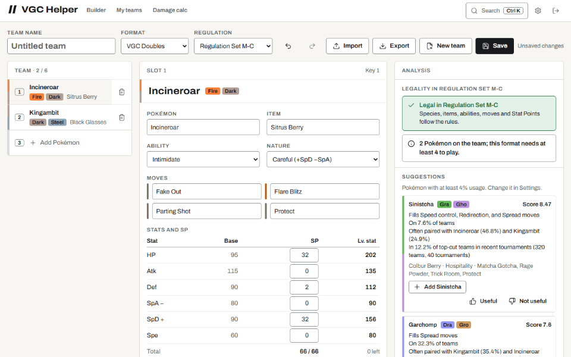
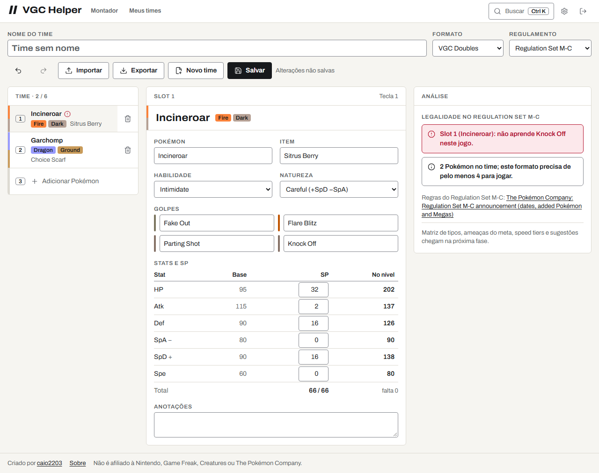
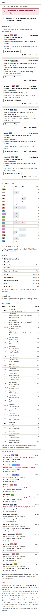
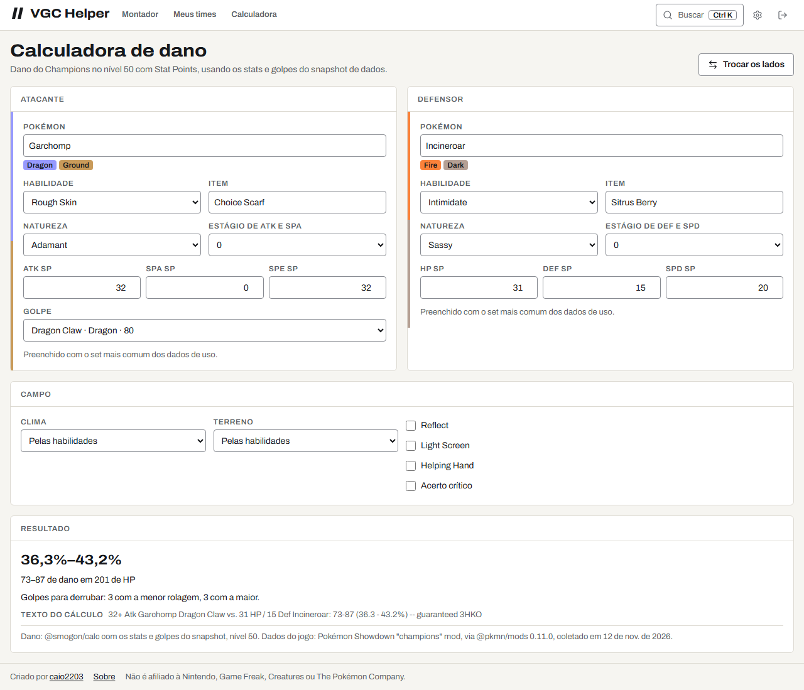
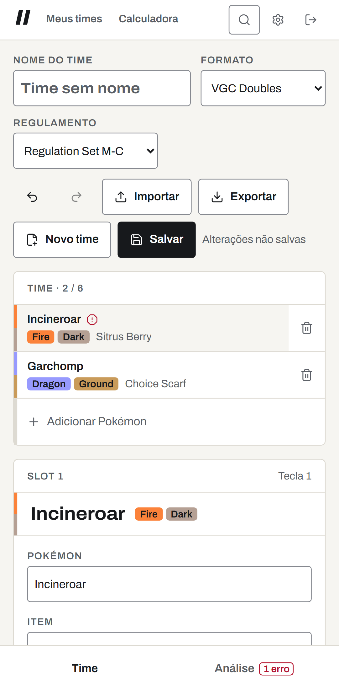
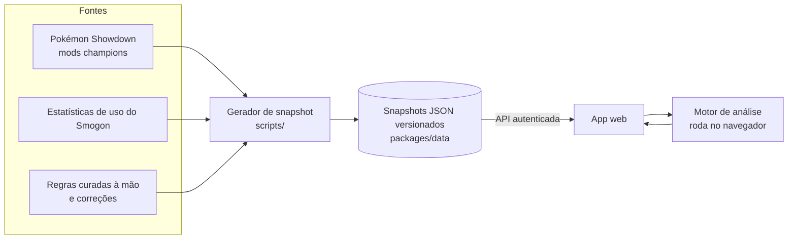
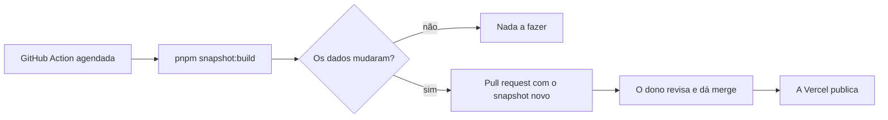

# VGC Helper

[English](README.md) · **Português (Brasil)**

Monte times de Pokémon competitivo e veja, enquanto monta, as fraquezas do time, o que está
faltando e o que o meta atual está usando. VGC (Doubles) primeiro, Singles depois.

[](https://github.com/caio2203/vgc-helper/actions/workflows/ci.yml)
[](LICENSE)
[](https://github.com/caio2203/vgc-helper/releases)

> **Status: início do desenvolvimento.** As Fases 2 e 3 estão prontas: o montador checa a
> legalidade enquanto você edita, e a coluna de análise mostra a matriz de tipos, as fraquezas
> acumuladas, o checklist de papéis, os speed tiers e as ameaças do meta com cálculo de dano,
> com sugestões que explicam a pontuação. Próximo passo: atualização dos dados com diffs
> legíveis — veja o [roadmap](#roadmap).

## Screenshots

Adicionar um Pokémon, ver o alerta, aceitar uma sugestão (gravado com a interface em inglês):



O montador ao lado da coluna de análise completa, e a calculadora de dano:

<p>
  <picture>
    <source media="(prefers-color-scheme: dark)" srcset="docs/images/builder-desktop-dark-pt-BR.png">
    
  </picture>
  <picture>
    <source media="(prefers-color-scheme: dark)" srcset="docs/images/analysis-desktop-dark-pt-BR.png">
    
  </picture>
</p>

<p>
  <picture>
    <source media="(prefers-color-scheme: dark)" srcset="docs/images/calc-desktop-dark-pt-BR.png">
    
  </picture>
  <picture>
    <source media="(prefers-color-scheme: dark)" srcset="docs/images/builder-mobile-dark-pt-BR.png">
    
  </picture>
</p>

A pasta `docs/images` tem todas as telas (montador, análise, calculadora de dano, Meus times,
configurações, login) no computador e no celular, no tema claro e no escuro, em inglês e em
português. Elas são geradas a partir de uma instância local descartável, com dados de
demonstração, por `pnpm --filter @vgc-helper/web screenshots`, que também grava o GIF; os ícones
e a imagem de prévia social vêm de `pnpm --filter @vgc-helper/web brand`.

## Por que eu fiz isso

Com o lançamento do Pokémon Champions, entrar no competitivo ficou bem mais fácil. O problema é que o meta muda o tempo todo, e eu (infelizmente) não consigo acompanhar tudo. Então resolvi fazer o helper que eu queria ter.

A ideia é ajudar todo mundo, de quem está começando a quem já joga há anos, a montar times com mais agilidade e facilidade. Em vez de passar horas pensando sozinho, no papel e caneta, e depois tomar várias porradas no Showdown (kkkkk), você monta o time e o app mostra as fraquezas, o que está faltando e o que o meta está usando.

Espero que aproveitem e curtam! Fiquem à vontade para sugerir melhorias, dar dicas, apontar erros e subir a sua própria cópia para usar do seu jeito.

## Funcionalidades

Já disponível:

- Privado por padrão: um dono por instância, login pelo GitHub restrito ao seu ID numérico
  (ou uma senha local, para rodar no seu PC).
- Dados do Pokémon Champions no Regulamento M-C: espécies, Megas, golpes, itens, habilidades e
  learnsets legais, mais estatísticas mensais de uso do VGC e do Singles. Cada conjunto de dados
  traz a fonte e a data.
- Montador de times com checagem de legalidade ao vivo contra o regulamento: espécies e formas,
  habilidades, learnsets, Stat Points, Item e Species Clause, Mega Stones e uma Mega por batalha.
  Cada erro diz o slot e a fonte da regra.
- Importação de paste do Showdown (cole em qualquer lugar da página) e exportação.
- Busca tolerante a erros de digitação de Pokémon, golpes, itens e habilidades, numa paleta de
  comandos.
- Atalhos de teclado, desfazer e refazer, e versões salvas de cada time.
- Meus times: salvar, abrir, duplicar e excluir times.
- Configurações: idioma, nível de experiência, densidade (confortável ou compacta), tema,
  formato padrão.
- App instalável (PWA). Só a estrutura do app fica em cache; seus dados nunca ficam offline.
- Interface em inglês e português do Brasil, temas claro e escuro.
- Análise ao vivo, sem IA, refeita a cada mudança:
  - matriz de tipos como mapa de calor com o valor em cada célula, considerando habilidades
    (Levitate, Flash Fire, Thick Fat…), fraquezas acumuladas com o membro que as completou e os
    Pokémon do meta que as exploram, e as lacunas da cobertura ofensiva;
  - checklist de papéis do VGC: controle de velocidade, Fake Out, redirecionamento, Intimidate e
    respostas a ele, Protect, golpes em área e de prioridade, pivots, Wide Guard, equilíbrio
    físico/especial, Megas;
  - arquétipos (Tailwind, Trick Room, climas, terrenos) e a peça que falta;
  - speed tiers numa régua ao lado dos Pokémon mais usados, com Tailwind e Choice Scarf;
  - ameaças do meta: os Pokémon mais usados, com o set mais comum, calculados contra o time,
    com quem eles derrubam com um golpe e quem responde a eles.
- Sugestões a partir dos dados de uso: Pokémon legais acima de um corte de uso configurável (ou
  abaixo dele no modo off-meta), ordenados por uma pontuação explicada — fraquezas acumuladas
  que resistem, papéis que faltam e que preenchem, uso, companheiros de time comuns — com o set
  mais comum, adicionados com um clique. Cada uma pode ser marcada como útil ou não; as
  Configurações mostram o total.
- Os níveis de experiência mudam quanto se explica e quantos números aparecem: o iniciante ganha
  um glossário em cada papel, o avançado ganha rolagens de dano e os pontos da pontuação.
- Calculadora de dano com a mecânica do Champions (Stat Points, nível 50), usando o mesmo
  cálculo e os mesmos dados da análise.
- Todo número traz a fonte e a data.

Planejado (veja o roadmap):

- Resultados de torneio como bônus na pontuação das sugestões.
- Explicações e chat sob demanda com o Google Gemini (free tier), e tudo funcionando sem ele.

## Atalhos de teclado

No macOS, use `Cmd` no lugar de `Ctrl`. Aperte `?` no app para ver esta lista.

| Teclas         | Ação                                                 |
| -------------- | ---------------------------------------------------- |
| `Ctrl K`       | Buscar Pokémon, golpes, itens e comandos             |
| `1` – `6`      | Selecionar o slot 1 a 6                              |
| `Ctrl Z`       | Desfazer                                             |
| `Ctrl Shift Z` | Refazer                                              |
| `Ctrl S`       | Salvar o time                                        |
| `Ctrl V`       | Colar um time do Showdown (fora dos campos de texto) |
| `Esc`          | Fechar um diálogo ou lista                           |
| `?`            | Mostrar os atalhos                                   |

## Como funciona



Os dados competitivos não ficam num banco de dados. Eles ficam como JSON versionado e validado
com zod dentro do repositório, então toda mudança pode ser revisada num pull request:



## Stack

| Parte      | Escolha                                                                                                                      |
| ---------- | ---------------------------------------------------------------------------------------------------------------------------- |
| Monorepo   | pnpm workspaces, Turborepo, TypeScript (estrito)                                                                             |
| API        | NestJS, Passport (OAuth do GitHub), Drizzle ORM, libSQL / SQLite                                                             |
| Web        | React, Vite, TanStack Router e Query, Zustand, react-i18next, Radix UI, Tailwind com os tokens do DESIGN.md, vite-plugin-pwa |
| Motor      | Pacote TypeScript puro, usado pelo web e pela API                                                                            |
| Dados      | Schemas zod, `@pkmn/dex` + `@pkmn/mods`, estatísticas do Smogon                                                              |
| Testes     | Vitest, Supertest, Playwright, axe                                                                                           |
| Hospedagem | Vercel (Hobby) + Turso (Free)                                                                                                |
| Qualidade  | Biome, commitlint, husky, CodeQL, Dependabot, release-please                                                                 |

## Início rápido (no seu PC)

Requisitos: [Node.js 24](https://nodejs.org/) e pnpm 12 (`npm install -g pnpm@12`).

```bash
git clone https://github.com/caio2203/vgc-helper.git
cd vgc-helper
pnpm install
cp .env.example .env
```

No `.env`, preencha o `SESSION_SECRET` (o comentário no arquivo tem um comando que gera um) e
mantenha `AUTH_MODE=local-password`. Depois gere o hash da sua senha e cole em
`ADMIN_PASSWORD_HASH`:

```bash
pnpm hash-password
```

Suba o app:

```bash
pnpm dev
```

Abra http://localhost:5173 e entre com a sua senha. Os dados ficam num arquivo SQLite local
(`apps/api/local.db`).

Para rodar tudo num processo só (a API também entrega o web já compilado):

```bash
pnpm build
```

Depois coloque `APP_ORIGIN=http://localhost:3000` e `SERVE_WEB_DIR=../web/dist` (relativo a
`apps/api`) no `.env` e rode:

```bash
pnpm start
```

## Subir a sua própria cópia (Vercel + Turso)

Os dois serviços têm planos grátis que bastam para uma pessoa. O guia completo, passo a passo e
com todos os valores para preencher, está em [docs/setup.pt-BR.md](docs/setup.pt-BR.md). Resumo:

1. Faça um fork deste repositório.
2. Crie um banco no Turso e um token para ele.
3. Importe o fork na Vercel. O `vercel.json` já define o build, a função e as rotas.
4. Adicione as variáveis de ambiente abaixo em **Production** e **Preview**.
5. Ligue a **Vercel Authentication** em **All Deployments** (Settings → Deployment Protection).
6. Crie um app OAuth no GitHub com o callback `https://<seu-domínio>/api/auth/github/callback`.

## Opções de login

| Modo             | Para quê                           | Variáveis                                                             |
| ---------------- | ---------------------------------- | --------------------------------------------------------------------- |
| `github`         | A sua instância online             | `GITHUB_CLIENT_ID`, `GITHUB_CLIENT_SECRET`, `AUTH_ALLOWED_GITHUB_IDS` |
| `local-password` | O seu PC, ou os deploys de preview | `ADMIN_PASSWORD_HASH` (saída do `pnpm hash-password`)                 |

`AUTH_ALLOWED_GITHUB_IDS` recebe IDs numéricos, não usernames, porque o username pode mudar.
Descubra o seu em `https://api.github.com/users/<seu-username>` (campo `id`). Qualquer outra conta
volta para a tela de login e nada é guardado sobre ela. Não existe cadastro nem tela de setup:
se a autenticação não estiver configurada, a API se recusa a subir.

## Variáveis de ambiente

| Variável                  | Obrigatória         | Descrição                                                              |
| ------------------------- | ------------------- | ---------------------------------------------------------------------- |
| `APP_ORIGIN`              | sim                 | Endereço que você abre no navegador, ex.: `https://helper.example.com` |
| `SESSION_SECRET`          | sim                 | Pelo menos 32 caracteres aleatórios                                    |
| `AUTH_MODE`               | sim                 | `github` ou `local-password`                                           |
| `GITHUB_CLIENT_ID`        | modo github         | Client ID do app OAuth                                                 |
| `GITHUB_CLIENT_SECRET`    | modo github         | Client secret do app OAuth                                             |
| `AUTH_ALLOWED_GITHUB_IDS` | modo github         | IDs numéricos do GitHub, separados por vírgula                         |
| `ADMIN_PASSWORD_HASH`     | modo local-password | Saída do `pnpm hash-password`                                          |
| `DATABASE_URL`            | não                 | Arquivo SQLite local, padrão `file:local.db`                           |
| `TURSO_DATABASE_URL`      | na Vercel           | URL `libsql://…` do banco no Turso                                     |
| `TURSO_AUTH_TOKEN`        | na Vercel           | Token do banco no Turso                                                |
| `CRON_SECRET`             | na Vercel           | 16+ caracteres; deixa o cron diário manter o banco grátis ativo        |
| `SESSION_TTL_DAYS`        | não                 | Duração da sessão em dias, padrão 30                                   |
| `SERVE_WEB_DIR`           | não                 | Entregar o web compilado pela API (um processo só)                     |
| `PORT`                    | não                 | Porta da API ao rodar localmente, padrão 3000                          |

## Fontes de dados e créditos

- [Pokémon Showdown](https://github.com/smogon/pokemon-showdown) (MIT) — dados de jogo dos mods
  do Pokémon Champions, empacotados pelo [pkmn](https://github.com/pkmn/ps) (MIT).
- [Estatísticas de uso do Smogon](https://www.smogon.com/stats/) — uso mensal, sets, spreads e
  companheiros de time.
- [@smogon/calc](https://github.com/smogon/damage-calc) (MIT) — cálculo de dano com a mecânica
  do Pokémon Champions, alimentado com os stats e golpes do snapshot de dados.
- Anúncios oficiais da The Pokémon Company — datas e regras dos regulamentos, creditados junto
  dos dados em `packages/data/manual`.

O arquivo [NOTICE](NOTICE) lista os créditos que precisam acompanhar qualquer cópia.

## Roadmap

- [x] **Fase 0** — pesquisa: regras, fontes de dados, limites da hospedagem
- [x] **Fase 1** — base: monorepo, CI, login, banco, i18n, primeiro snapshot de dados, primeiro deploy
- [x] **Fase 2** — design system, montador de times, legalidade, import/export de paste, busca, atalhos
- [x] **Fase 3** — motor de análise, sugestões, níveis de experiência, feedback, calculadora de dano
- [ ] **Fase 4** — pipeline de dados com diff legível, página "Novidades", revalidação de times
- [ ] **Fase 5** — team preview: quais 4 levar contra uma Open Team List
- [ ] **Fase 6** — explicações e chat com IA sob demanda (Gemini)
- [ ] **Fase 7** — perfil de análise de Singles
- [ ] **Fase 8** — Scarlet/Violet e formatos do Smogon

## Como contribuir

Issues e pull requests são bem-vindos. Leia o [CONTRIBUTING.md](CONTRIBUTING.md) antes (em
inglês). Para dado errado do meta ou regulamento novo, use o template de issue correspondente.
Falhas de segurança são reportadas em privado, como explica o [SECURITY.md](SECURITY.md).

## Licença

[Apache License 2.0](LICENSE). Você pode usar, alterar e redistribuir este projeto, inclusive
comercialmente. Mantenha o arquivo [NOTICE](NOTICE) em qualquer cópia que distribuir e, por
favor, mantenha o crédito "Created by caio2203" no app.

## Aviso

O VGC Helper é um projeto de fã. Ele não é afiliado à Nintendo, Game Freak, Creatures ou The
Pokémon Company, nem patrocinado ou endossado por elas. Pokémon e todos os nomes relacionados
são marcas registradas dos seus respectivos donos.
