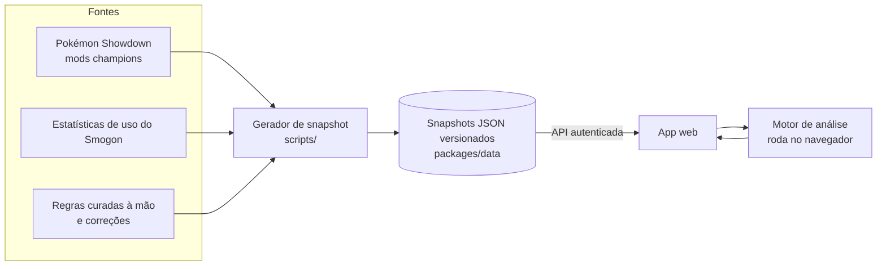
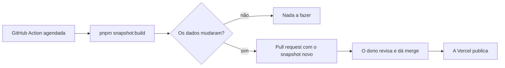

# VGC Helper

[English](README.md) · **Português (Brasil)**

Monte times de Pokémon competitivo e veja, enquanto monta, as fraquezas do time, o que está
faltando e o que o meta atual está usando. VGC (Doubles) primeiro, Singles depois.

[](https://github.com/caio2203/vgc-helper/actions/workflows/ci.yml)
[](LICENSE)
[](https://github.com/caio2203/vgc-helper/releases)

> **Status: início do desenvolvimento.** A base está pronta (login, pipeline de dados e dados do
> Regulamento M-C do Pokémon Champions). O montador de times e a análise vêm a seguir — veja o
> [roadmap](#roadmap). Os screenshots entram quando houver o que mostrar.

## Por que eu fiz isso

Com o lançamento do Pokémon Champions, entrar no competitivo ficou bem mais fácil. O problema é que o meta muda o tempo todo, e eu (infelizmente) não consigo acompanhar tudo. Então resolvi fazer o helper que eu queria ter.

A ideia é ajudar todo mundo, de quem está começando a quem já joga há anos, a montar times com mais agilidade e facilidade. Em vez de passar horas pensando sozinho, no papel e caneta, e depois tomar várias porradas no Showdown (kkkkk), você monta o time e o app mostra as fraquezas, o que está faltando e o que o meta está usando.

Espero que aproveitem e curtam! Fiquem à vontade para sugerir melhorias, dar dicas, apontar erros e subir a sua própria cópia para usar do seu jeito.

## Funcionalidades

Já disponível:

- Privado por padrão: um dono por instância, login pelo GitHub restrito ao seu ID numérico
  (ou uma senha local, para rodar no seu PC).
- Dados do Pokémon Champions no Regulamento M-C: espécies, Megas, golpes, itens, habilidades e
  learnsets legais, mais estatísticas mensais de uso do VGC e do Singles. Cada conjunto de dados
  traz a fonte e a data.
- Interface em inglês e português do Brasil.

Planejado (veja o roadmap):

- Montador de times com checagem de legalidade (Stat Points, Item e Species Clause, uma Mega).
- Análise ao vivo, sem IA: matriz de tipos, fraquezas acumuladas, ameaças do meta com cálculo
  de dano, speed tiers, checklist de papéis do VGC, detecção de arquétipo.
- Sugestões com pontuação explicada e o set mais usado, a partir de dados de uso e de torneios.
- Importação e exportação no formato paste do Showdown.
- Explicações e chat sob demanda com o Google Gemini (free tier), e tudo funcionando sem ele.

## Como funciona



Os dados competitivos não ficam num banco de dados. Eles ficam como JSON versionado e validado
com zod dentro do repositório, então toda mudança pode ser revisada num pull request:



## Stack

| Parte      | Escolha                                                          |
| ---------- | ---------------------------------------------------------------- |
| Monorepo   | pnpm workspaces, Turborepo, TypeScript (estrito)                 |
| API        | NestJS, Passport (OAuth do GitHub), Drizzle ORM, libSQL / SQLite |
| Web        | React, Vite, TanStack Router e Query, react-i18next              |
| Motor      | Pacote TypeScript puro, usado pelo web e pela API                |
| Dados      | Schemas zod, `@pkmn/dex` + `@pkmn/mods`, estatísticas do Smogon  |
| Testes     | Vitest, Supertest, Playwright, axe                               |
| Hospedagem | Vercel (Hobby) + Turso (Free)                                    |
| Qualidade  | Biome, commitlint, husky, CodeQL, Dependabot, release-please     |

## Início rápido (no seu PC)

Requisitos: [Node.js 24](https://nodejs.org/) e pnpm 12 (`npm install -g pnpm@12`).

```bash
git clone https://github.com/caio2203/vgc-helper.git
cd vgc-helper
pnpm install
cp .env.example .env
```

No `.env`, preencha o `SESSION_SECRET` (o comentário no arquivo tem um comando que gera um) e
mantenha `AUTH_MODE=local-password`. Depois gere o hash da sua senha e cole em
`ADMIN_PASSWORD_HASH`:

```bash
pnpm hash-password
```

Suba o app:

```bash
pnpm dev
```

Abra http://localhost:5173 e entre com a sua senha. Os dados ficam num arquivo SQLite local
(`apps/api/local.db`).

Para rodar tudo num processo só (a API também entrega o web já compilado):

```bash
pnpm build
```

Depois coloque `APP_ORIGIN=http://localhost:3000` e `SERVE_WEB_DIR=../web/dist` (relativo a
`apps/api`) no `.env` e rode:

```bash
pnpm start
```

## Subir a sua própria cópia (Vercel + Turso)

Os dois serviços têm planos grátis que bastam para uma pessoa. O guia completo, passo a passo e
com todos os valores para preencher, está em [docs/setup.pt-BR.md](docs/setup.pt-BR.md). Resumo:

1. Faça um fork deste repositório.
2. Crie um banco no Turso e um token para ele.
3. Importe o fork na Vercel. O `vercel.json` já define o build, a função e as rotas.
4. Adicione as variáveis de ambiente abaixo em **Production** e **Preview**.
5. Ligue a **Vercel Authentication** em **All Deployments** (Settings → Deployment Protection).
6. Crie um app OAuth no GitHub com o callback `https://<seu-domínio>/api/auth/github/callback`.

## Opções de login

| Modo             | Para quê                           | Variáveis                                                             |
| ---------------- | ---------------------------------- | --------------------------------------------------------------------- |
| `github`         | A sua instância online             | `GITHUB_CLIENT_ID`, `GITHUB_CLIENT_SECRET`, `AUTH_ALLOWED_GITHUB_IDS` |
| `local-password` | O seu PC, ou os deploys de preview | `ADMIN_PASSWORD_HASH` (saída do `pnpm hash-password`)                 |

`AUTH_ALLOWED_GITHUB_IDS` recebe IDs numéricos, não usernames, porque o username pode mudar.
Descubra o seu em `https://api.github.com/users/<seu-username>` (campo `id`). Qualquer outra conta
volta para a tela de login e nada é guardado sobre ela. Não existe cadastro nem tela de setup:
se a autenticação não estiver configurada, a API se recusa a subir.

## Variáveis de ambiente

| Variável                  | Obrigatória         | Descrição                                                              |
| ------------------------- | ------------------- | ---------------------------------------------------------------------- |
| `APP_ORIGIN`              | sim                 | Endereço que você abre no navegador, ex.: `https://helper.example.com` |
| `SESSION_SECRET`          | sim                 | Pelo menos 32 caracteres aleatórios                                    |
| `AUTH_MODE`               | sim                 | `github` ou `local-password`                                           |
| `GITHUB_CLIENT_ID`        | modo github         | Client ID do app OAuth                                                 |
| `GITHUB_CLIENT_SECRET`    | modo github         | Client secret do app OAuth                                             |
| `AUTH_ALLOWED_GITHUB_IDS` | modo github         | IDs numéricos do GitHub, separados por vírgula                         |
| `ADMIN_PASSWORD_HASH`     | modo local-password | Saída do `pnpm hash-password`                                          |
| `DATABASE_URL`            | não                 | Arquivo SQLite local, padrão `file:local.db`                           |
| `TURSO_DATABASE_URL`      | na Vercel           | URL `libsql://…` do banco no Turso                                     |
| `TURSO_AUTH_TOKEN`        | na Vercel           | Token do banco no Turso                                                |
| `CRON_SECRET`             | na Vercel           | 16+ caracteres; deixa o cron diário manter o banco grátis ativo        |
| `SESSION_TTL_DAYS`        | não                 | Duração da sessão em dias, padrão 30                                   |
| `SERVE_WEB_DIR`           | não                 | Entregar o web compilado pela API (um processo só)                     |
| `PORT`                    | não                 | Porta da API ao rodar localmente, padrão 3000                          |

## Fontes de dados e créditos

- [Pokémon Showdown](https://github.com/smogon/pokemon-showdown) (MIT) — dados de jogo dos mods
  do Pokémon Champions, empacotados pelo [pkmn](https://github.com/pkmn/ps) (MIT).
- [Estatísticas de uso do Smogon](https://www.smogon.com/stats/) — uso mensal, sets, spreads e
  companheiros de time.
- Anúncios oficiais da The Pokémon Company — datas e regras dos regulamentos, creditados junto
  dos dados em `packages/data/manual`.

O arquivo [NOTICE](NOTICE) lista os créditos que precisam acompanhar qualquer cópia.

## Roadmap

- [x] **Fase 0** — pesquisa: regras, fontes de dados, limites da hospedagem
- [ ] **Fase 1** — base: monorepo, CI, login, banco, i18n, primeiro snapshot de dados, primeiro deploy
- [ ] **Fase 2** — design system, montador de times, legalidade, import/export de paste, busca, atalhos
- [ ] **Fase 3** — motor de análise, sugestões, níveis de experiência, feedback, calculadora de dano
- [ ] **Fase 4** — pipeline de dados com diff legível, página "Novidades", revalidação de times
- [ ] **Fase 5** — team preview: quais 4 levar contra uma Open Team List
- [ ] **Fase 6** — explicações e chat com IA sob demanda (Gemini)
- [ ] **Fase 7** — perfil de análise de Singles
- [ ] **Fase 8** — Scarlet/Violet e formatos do Smogon

## Como contribuir

Issues e pull requests são bem-vindos. Leia o [CONTRIBUTING.md](CONTRIBUTING.md) antes (em
inglês). Para dado errado do meta ou regulamento novo, use o template de issue correspondente.
Falhas de segurança são reportadas em privado, como explica o [SECURITY.md](SECURITY.md).

## Licença

[Apache License 2.0](LICENSE). Você pode usar, alterar e redistribuir este projeto, inclusive
comercialmente. Mantenha o arquivo [NOTICE](NOTICE) em qualquer cópia que distribuir e, por
favor, mantenha o crédito "Created by caio2203" no app.

## Aviso

O VGC Helper é um projeto de fã. Ele não é afiliado à Nintendo, Game Freak, Creatures ou The
Pokémon Company, nem patrocinado ou endossado por elas. Pokémon e todos os nomes relacionados
são marcas registradas dos seus respectivos donos.
