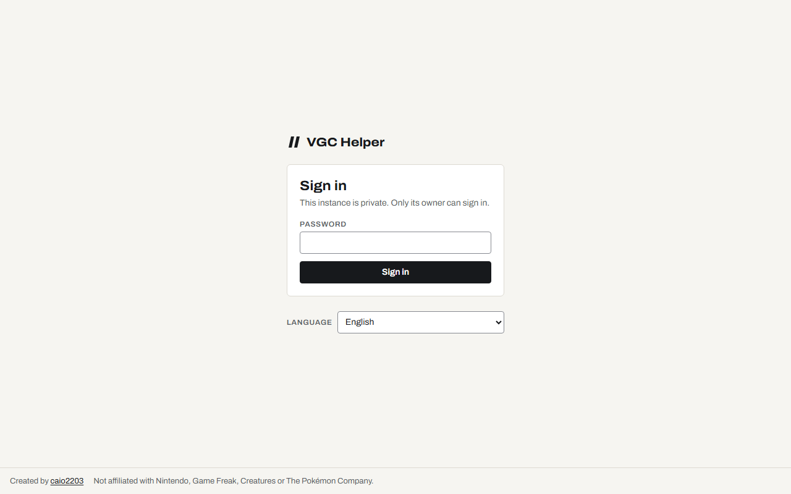
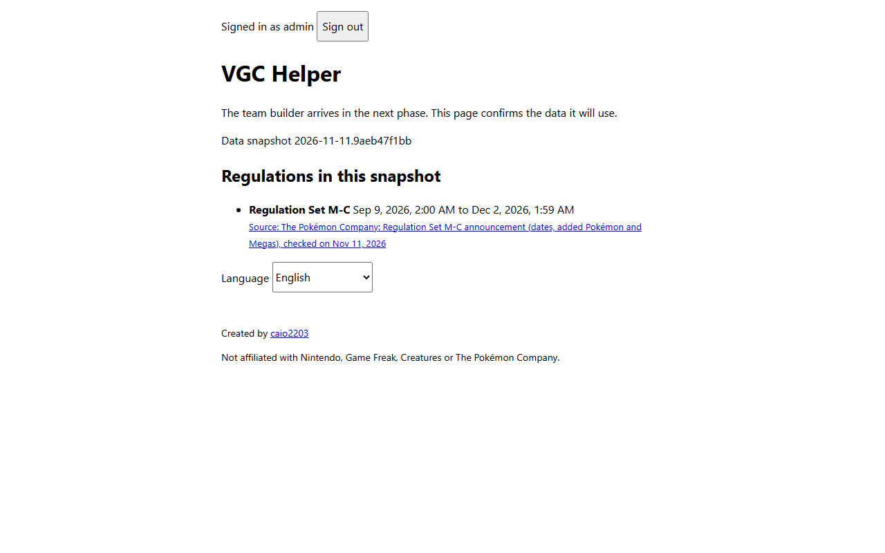

# Setup guide

**English** · [Português (Brasil)](setup.pt-BR.md)

How to run VGC Helper on your PC, or as your own private instance on Vercel + Turso. Every value
you need to type is spelled out. **Secrets (client secrets, tokens, keys) go straight into
Vercel or GitHub, never into a file you commit or a chat.**

- [1. Run it on your PC](#1-run-it-on-your-pc)
- [2. Your own online instance](#2-your-own-online-instance-vercel--turso)
- [3. Data update pull requests (GitHub App)](#3-data-update-pull-requests-github-app)
- [4. Repository settings for maintainers](#4-repository-settings-for-maintainers)

## 1. Run it on your PC

Install [Node.js 24](https://nodejs.org/) and pnpm 12:

```bash
npm install -g pnpm@12
```

Then:

```bash
pnpm install
cp .env.example .env
```

Generate a session secret and paste it into `SESSION_SECRET` in `.env`:

```bash
node -e "console.log(require('crypto').randomBytes(32).toString('base64url'))"
```

Generate the hash of the password you want to use and paste it into `ADMIN_PASSWORD_HASH`
(the password itself is never stored):

```bash
pnpm hash-password
```

In Windows PowerShell, use `pnpm.cmd hash-password`: the `pnpm.ps1` shim does not pass your
keyboard input to the script.

Keep `AUTH_MODE=local-password` and start:

```bash
pnpm dev
```

Open http://localhost:5173. The data lives in `apps/api/local.db`. You should see the sign-in
screen; after signing in, the page lists the data snapshot and its regulations:

<p>
  <picture>
    <source media="(prefers-color-scheme: dark)" srcset="images/login-desktop-dark.png">
    
  </picture>
  <picture>
    <source media="(prefers-color-scheme: dark)" srcset="images/home-desktop-dark.png">
    
  </picture>
</p>

On your online instance the GitHub button replaces the password field, and Vercel asks you to
log in before this screen appears.

## 2. Your own online instance (Vercel + Turso)

You need a GitHub account (personal, not an organization — the Vercel Hobby plan cannot
connect organization repositories), a [Vercel](https://vercel.com/signup) account and a
[Turso](https://app.turso.tech) account. Both free plans are enough.

### 2.1 Fork the repository

Fork https://github.com/caio2203/vgc-helper to your account.

### 2.2 Create the databases on Turso

Create two databases, one for production and one for preview deployments, in the
[Turso dashboard](https://app.turso.tech):

| Field    | Production                                                                | Preview              |
| -------- | ------------------------------------------------------------------------- | -------------------- |
| Name     | `vgc-helper`                                                              | `vgc-helper-preview` |
| Location | close to your Vercel function region (default `iad1`, so AWS `us-east-1`) | same                 |

For each database, copy its URL (starts with `libsql://`) and create a token with read and
write access. Keep the tab open: the token goes straight into Vercel in step 2.5.

With the Turso CLI (macOS, Linux or WSL) the same is:

```bash
turso db create vgc-helper
turso db show vgc-helper --url
turso db tokens create vgc-helper
```

> Free Turso databases are archived after 10 days without use. The app's daily cron
> (`/api/internal/keepalive`) runs a read to prevent that. If it ever happens, unarchive it in
> the dashboard or with `turso group unarchive <group>`.

### 2.3 Find your numeric GitHub id

Open `https://api.github.com/users/<your-username>` and copy the number in `"id"`. Usernames can
change, ids cannot, so the allowlist uses the id.

### 2.4 Create the GitHub OAuth app

Go to https://github.com/settings/applications/new and fill in:

| Field                      | Value                                                        |
| -------------------------- | ------------------------------------------------------------ |
| Application name           | `VGC Helper`                                                 |
| Homepage URL               | `https://<your-project>.vercel.app`                          |
| Authorization callback URL | `https://<your-project>.vercel.app/api/auth/github/callback` |
| Enable Device Flow         | unchecked                                                    |

Click **Register application**, then **Generate a new client secret**. You will paste the Client
ID and the secret into Vercel next. If you do not know the project URL yet, finish step 2.5
first and come back: the URL is shown after the first deploy.

### 2.5 Create the Vercel project

1. Go to https://vercel.com/new and import your fork.
2. Leave **Root Directory** as the repository root and do not change the build settings:
   `vercel.json` defines them.
3. Before deploying, open **Environment Variables** and add:

| Variable                  | Production                             | Preview                                       |
| ------------------------- | -------------------------------------- | --------------------------------------------- |
| `AUTH_MODE`               | `github`                               | `local-password`                              |
| `SESSION_SECRET`          | a new random value (command in step 1) | a different random value                      |
| `GITHUB_CLIENT_ID`        | from step 2.4                          | —                                             |
| `GITHUB_CLIENT_SECRET`    | from step 2.4 (mark as **Sensitive**)  | —                                             |
| `AUTH_ALLOWED_GITHUB_IDS` | your id from step 2.3                  | —                                             |
| `ADMIN_PASSWORD_HASH`     | —                                      | output of `pnpm hash-password`                |
| `TURSO_DATABASE_URL`      | URL of `vgc-helper`                    | URL of `vgc-helper-preview`                   |
| `TURSO_AUTH_TOKEN`        | token of `vgc-helper` (**Sensitive**)  | token of `vgc-helper-preview` (**Sensitive**) |
| `CRON_SECRET`             | 16+ random characters (**Sensitive**)  | —                                             |

`APP_ORIGIN` is optional on Vercel: the app reads its own URLs from Vercel's system variables.
Set it only if you use a custom domain.

Previews use the password login because a GitHub OAuth app accepts only one callback URL and
every preview has its own address.

4. Click **Deploy**. Without these variables the API refuses to start, by design.

### 2.6 Lock the whole project with Vercel Authentication

In the project: **Settings → Deployment Protection → Vercel Authentication**, turn it on and pick
**All Deployments**. Now production and every preview first require a Vercel login with access
to your project, before the app's own login.

If you later run tests against previews, create a secret under **Protection Bypass for
Automation** in the same page.

### 2.7 Check that it worked

1. Open `https://<your-project>.vercel.app` in a private window: Vercel asks you to log in.
2. After that, the app shows only its login screen. Sign in with GitHub.
3. Try it with another GitHub account: you get "This GitHub account is not allowed".
4. In **Settings → Cron Jobs** you should see `/api/internal/keepalive` once a day.

## 3. Data update pull requests (GitHub App)

The `Update data` workflow rebuilds the data snapshot every day and opens a pull request when it
changed. Pull requests opened with the default `GITHUB_TOKEN` do not start other workflows, so CI
would not run on them. A small GitHub App fixes that.

1. Go to https://github.com/settings/apps/new and fill in:

| Field                                   | Value                                             |
| --------------------------------------- | ------------------------------------------------- |
| GitHub App name                         | `vgc-helper-bot-<your-username>` (must be unique) |
| Homepage URL                            | your fork's URL                                   |
| Webhook → Active                        | unchecked                                         |
| Repository permissions → Contents       | Read and write                                    |
| Repository permissions → Pull requests  | Read and write                                    |
| Repository permissions → Issues         | Read and write (labels on the pull requests)      |
| Where can this GitHub App be installed? | Only on this account                              |

2. Click **Create GitHub App** and note the **App ID**.
3. Under **Private keys**, click **Generate a private key**. A `.pem` file downloads.
4. Click **Install App**, choose your account and **Only select repositories** → your fork.
5. Store the id and the key in the repository (run in your own terminal, from the repository folder):

```bash
gh variable set BOT_APP_ID --body "<App ID>"
```

```bash
gh secret set BOT_APP_PRIVATE_KEY < path/to/the-downloaded-key.pem
```

6. Delete the `.pem` file from your computer. Run the workflow once from the **Actions** tab
   (**Update data → Run workflow**) to check it.

Release pull requests (release-please) use the same app, so CI runs on them too. Until the app is set up, the `Release Please` workflow is skipped.

## 4. Repository settings for maintainers

These are the settings of the main repository. Forks can copy them.

- **About**: short description and topics, no website link to a private instance.
- **Code security**: Dependabot alerts, secret scanning with push protection and private
  vulnerability reporting turned on.
- **Rules → Rulesets** for `main`: require the `ci` status check, block force pushes and
  deletion, with a bypass for the repository admin.
- **Social preview**: upload `docs/images/social-preview.png` (made with the logo in Phase 2) under **Settings → General**
  (manual, GitHub has no API for it).
