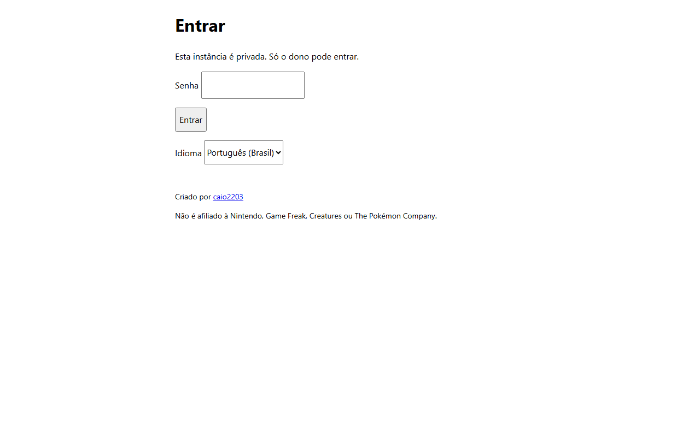
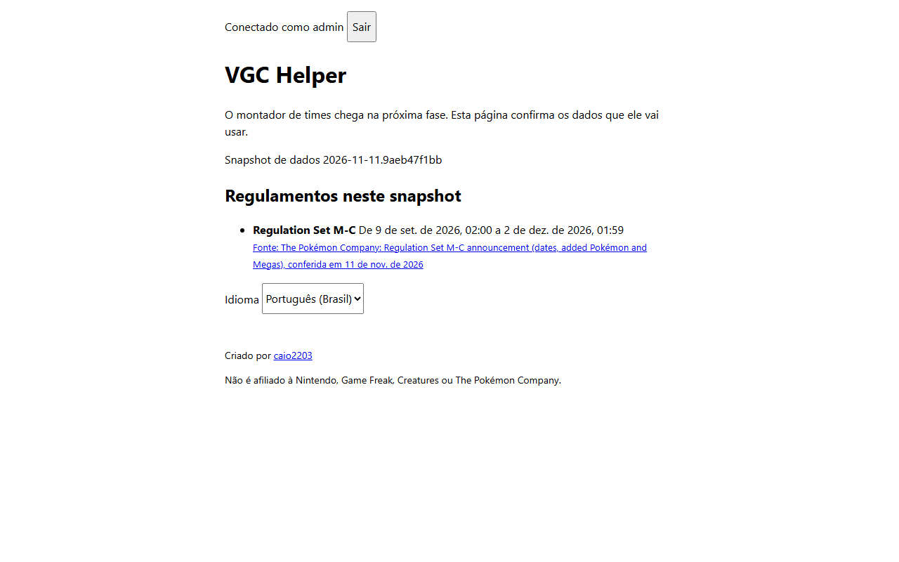

# Guia de setup

[English](setup.md) · **Português (Brasil)**

Como rodar o VGC Helper no seu PC, ou como a sua própria instância privada na Vercel + Turso.
Todos os valores que você precisa digitar estão aqui. **Segredos (client secrets, tokens,
chaves) vão direto para a Vercel ou para o GitHub, nunca para um arquivo commitado ou um chat.**

- [1. Rodar no seu PC](#1-rodar-no-seu-pc)
- [2. A sua instância online](#2-a-sua-instância-online-vercel--turso)
- [3. Pull requests de atualização de dados (GitHub App)](#3-pull-requests-de-atualização-de-dados-github-app)
- [4. Configurações do repositório para mantenedores](#4-configurações-do-repositório-para-mantenedores)

## 1. Rodar no seu PC

Instale o [Node.js 24](https://nodejs.org/) e o pnpm 12:

```bash
npm install -g pnpm@12
```

Depois:

```bash
pnpm install
cp .env.example .env
```

Gere um segredo de sessão e cole em `SESSION_SECRET` no `.env`:

```bash
node -e "console.log(require('crypto').randomBytes(32).toString('base64url'))"
```

Gere o hash da senha que você quer usar e cole em `ADMIN_PASSWORD_HASH` (a senha em si nunca
é guardada):

```bash
pnpm hash-password
```

No PowerShell do Windows, use `pnpm.cmd hash-password`: o atalho `pnpm.ps1` não repassa o que
você digita para o script.

Mantenha `AUTH_MODE=local-password` e suba:

```bash
pnpm dev
```

Abra http://localhost:5173. Os dados ficam em `apps/api/local.db`. Deve aparecer a tela de
login; depois de entrar, a página lista o snapshot de dados e os regulamentos:

<p>
  <picture>
    <source media="(prefers-color-scheme: dark)" srcset="images/login-desktop-dark-pt-BR.png">
    
  </picture>
  <picture>
    <source media="(prefers-color-scheme: dark)" srcset="images/home-desktop-dark-pt-BR.png">
    
  </picture>
</p>

Na sua instância online, o botão do GitHub aparece no lugar do campo de senha, e a Vercel pede
login antes desta tela.

## 2. A sua instância online (Vercel + Turso)

Você precisa de uma conta no GitHub (pessoal, não de organização — o plano Hobby da Vercel não
conecta repositórios de organização), uma conta na [Vercel](https://vercel.com/signup) e uma no
[Turso](https://app.turso.tech). Os planos grátis dos dois bastam.

### 2.1 Faça um fork do repositório

Faça um fork de https://github.com/caio2203/vgc-helper para a sua conta.

### 2.2 Crie os bancos no Turso

Crie dois bancos, um para produção e um para os deploys de preview, no
[painel do Turso](https://app.turso.tech):

| Campo       | Produção                                                                     | Preview              |
| ----------- | ---------------------------------------------------------------------------- | -------------------- |
| Nome        | `vgc-helper`                                                                 | `vgc-helper-preview` |
| Localização | perto da região das funções da Vercel (padrão `iad1`, então AWS `us-east-1`) | a mesma              |

Para cada banco, copie a URL (começa com `libsql://`) e crie um token com leitura e escrita.
Deixe a aba aberta: o token vai direto para a Vercel no passo 2.5.

Com o CLI do Turso (macOS, Linux ou WSL), o mesmo fica assim:

```bash
turso db create vgc-helper
turso db show vgc-helper --url
turso db tokens create vgc-helper
```

> Bancos grátis do Turso são arquivados depois de 10 dias sem uso. O cron diário do app
> (`/api/internal/keepalive`) faz uma leitura para isso não acontecer. Se acontecer, desarquive
> pelo painel ou com `turso group unarchive <grupo>`.

### 2.3 Descubra o seu ID numérico do GitHub

Abra `https://api.github.com/users/<seu-username>` e copie o número em `"id"`. O username pode
mudar, o ID não, por isso a lista de acesso usa o ID.

### 2.4 Crie o app OAuth no GitHub

Entre em https://github.com/settings/applications/new e preencha:

| Campo                      | Valor                                                       |
| -------------------------- | ----------------------------------------------------------- |
| Application name           | `VGC Helper`                                                |
| Homepage URL               | `https://<seu-projeto>.vercel.app`                          |
| Authorization callback URL | `https://<seu-projeto>.vercel.app/api/auth/github/callback` |
| Enable Device Flow         | desmarcado                                                  |

Clique em **Register application** e depois em **Generate a new client secret**. O Client ID e
o secret vão para a Vercel no próximo passo. Se você ainda não sabe a URL do projeto, faça o
passo 2.5 primeiro e volte aqui: a URL aparece depois do primeiro deploy.

### 2.5 Crie o projeto na Vercel

1. Entre em https://vercel.com/new e importe o seu fork.
2. Deixe o **Root Directory** na raiz do repositório e não mexa nas configurações de build:
   o `vercel.json` já define tudo.
3. Antes do deploy, abra **Environment Variables** e adicione:

| Variável                  | Production                                   | Preview                                       |
| ------------------------- | -------------------------------------------- | --------------------------------------------- |
| `AUTH_MODE`               | `github`                                     | `local-password`                              |
| `SESSION_SECRET`          | um valor aleatório novo (comando no passo 1) | outro valor aleatório                         |
| `GITHUB_CLIENT_ID`        | do passo 2.4                                 | —                                             |
| `GITHUB_CLIENT_SECRET`    | do passo 2.4 (marque como **Sensitive**)     | —                                             |
| `AUTH_ALLOWED_GITHUB_IDS` | o seu ID do passo 2.3                        | —                                             |
| `ADMIN_PASSWORD_HASH`     | —                                            | saída do `pnpm hash-password`                 |
| `TURSO_DATABASE_URL`      | URL do `vgc-helper`                          | URL do `vgc-helper-preview`                   |
| `TURSO_AUTH_TOKEN`        | token do `vgc-helper` (**Sensitive**)        | token do `vgc-helper-preview` (**Sensitive**) |
| `CRON_SECRET`             | 16+ caracteres aleatórios (**Sensitive**)    | —                                             |

O `APP_ORIGIN` é opcional na Vercel: o app lê as próprias URLs das variáveis de sistema da
Vercel. Só defina se usar um domínio próprio.

Os previews usam login por senha porque um app OAuth do GitHub aceita só uma URL de callback, e
cada preview tem um endereço diferente.

4. Clique em **Deploy**. Sem essas variáveis a API se recusa a subir, de propósito.

### 2.6 Tranque o projeto inteiro com a Vercel Authentication

No projeto: **Settings → Deployment Protection → Vercel Authentication**, ligue e escolha
**All Deployments**. Agora a produção e todos os previews pedem primeiro um login na Vercel com
acesso ao seu projeto, antes do login do próprio app.

Se depois você for rodar testes nos previews, crie um segredo em **Protection Bypass for
Automation**, na mesma página.

### 2.7 Confira se funcionou

1. Abra `https://<seu-projeto>.vercel.app` numa janela anônima: a Vercel pede login.
2. Depois disso, o app mostra só a tela de login dele. Entre com o GitHub.
3. Teste com outra conta do GitHub: aparece "Esta conta do GitHub não tem acesso".
4. Em **Settings → Cron Jobs** deve aparecer `/api/internal/keepalive`, uma vez por dia.

## 3. Pull requests de atualização de dados (GitHub App)

O workflow `Update data` refaz o snapshot de dados todo dia e abre um pull request quando algo
mudou. Pull requests abertos com o `GITHUB_TOKEN` padrão não disparam outros workflows, então o
CI não rodaria neles. Um GitHub App pequeno resolve isso.

1. Entre em https://github.com/settings/apps/new e preencha:

| Campo                                   | Valor                                               |
| --------------------------------------- | --------------------------------------------------- |
| GitHub App name                         | `vgc-helper-bot-<seu-username>` (precisa ser único) |
| Homepage URL                            | a URL do seu fork                                   |
| Webhook → Active                        | desmarcado                                          |
| Repository permissions → Contents       | Read and write                                      |
| Repository permissions → Pull requests  | Read and write                                      |
| Where can this GitHub App be installed? | Only on this account                                |

2. Clique em **Create GitHub App** e anote o **App ID**.
3. Em **Private keys**, clique em **Generate a private key**. Um arquivo `.pem` é baixado.
4. Clique em **Install App**, escolha a sua conta e **Only select repositories** → o seu fork.
5. Guarde o ID e a chave no repositório (rode no seu terminal, dentro da pasta do repositório):

```bash
gh variable set BOT_APP_ID --body "<App ID>"
```

```bash
gh secret set BOT_APP_PRIVATE_KEY < caminho/para/a-chave-baixada.pem
```

6. Apague o arquivo `.pem` do computador. Rode o workflow uma vez pela aba **Actions**
   (**Update data → Run workflow**) para conferir.

Os pull requests de release (release-please) usam o mesmo app, então o CI roda neles também. Até o app existir, o workflow `Release Please` fica pulado.

## 4. Configurações do repositório para mantenedores

Estas são as configurações do repositório principal. Forks podem copiar.

- **About**: descrição curta e tópicos, sem link para uma instância privada.
- **Code security**: alertas do Dependabot, secret scanning com push protection e private
  vulnerability reporting ligados.
- **Rules → Rulesets** na `main`: exigir o status check `ci`, bloquear force push e exclusão,
  com bypass para o admin do repositório.
- **Social preview**: envie `docs/images/social-preview.png` (feita com o logo na Fase 2) em **Settings → General** (manual,
  o GitHub não tem API para isso).
